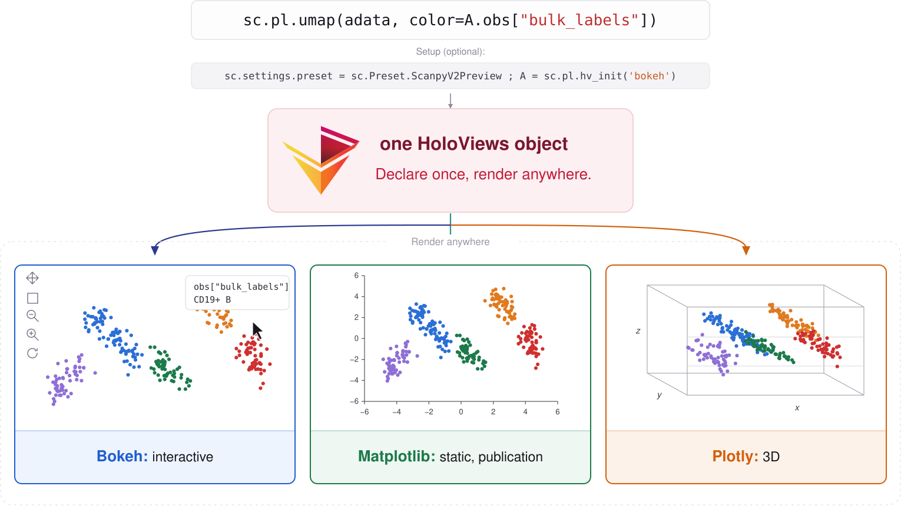
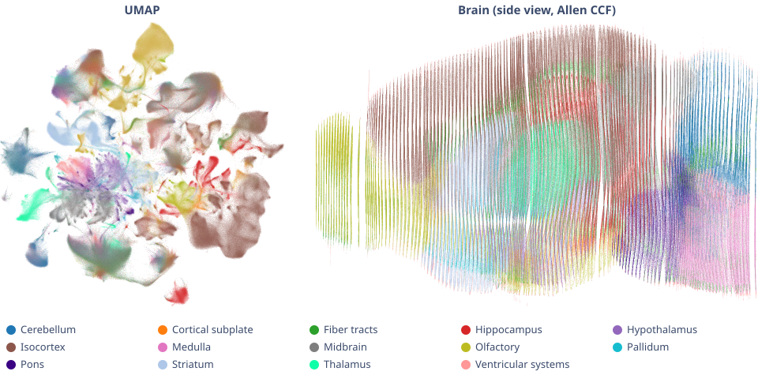

+++
title = "A new plotting backend for Scanpy: HoloViews"
date = 2026-11-13T00:00:05+01:00
description = "An opt-in HoloViews plotting backend for Scanpy, in preview."
author = "Muskan Hashim, Philipp Angerer"
+++



Scanpy's plotting API has served the single-cell community well for years.
But datasets have outgrown static images.

We routinely work with hundreds of thousands, sometimes millions, of cells, and the questions we ask are increasingly interactive: which cells are those, what's the expression of this gene here, how do these two embeddings line up?
Answering them, and more, with a static PNG means re-running a cell, tweaking a parameter, and re-running again.

So we've been rebuilding `sc.pl` on a new foundation: [HoloViews](https://holoviews.org/).
It's available today as an opt-in preview, and we'd love your feedback while it's still taking shape.

## What is HoloViews?

[HoloViews](https://holoviews.org/) is part of the [HoloViz](https://holoviz.org/) family of open-source Python visualization tools, alongside [Panel](https://panel.holoviz.org/), [Datashader](https://datashader.org/), and [hvPlot](https://hvplot.holoviz.org/).
Its central design principle is that the declaration of your data is independent from how it's plotted.

A HoloViews object is an annotated data container that knows how to render itself.
You describe what to show (the x and y dimensions, the value to color by), and HoloViews handles how to draw it.
Because the object carries its data, you can inspect it, slice it, compose it, and switch rendering backends without touching your analysis code.

The same object renders through three backends, which means you can write the plot once and pick the one that best fits the moment:

- [Bokeh](https://bokeh.org/) for interactive plots in the browser: pan, zoom, hover, and select.
- [Matplotlib](https://matplotlib.org/) for publication-quality static figures.
- [Plotly](https://plotly.com/python/) for interactive 3D.

## How it fits Scanpy and scverse

HoloViews can be taught to speak [AnnData](https://anndata.readthedocs.io/) natively.
A small companion package, [hv-anndata](https://hv-anndata.readthedocs.io/en/latest/), gives HoloViews a first-class AnnData interface and the `A` accessor for pointing at any part of your object.

Most of the time you use the `sc.pl` shortcuts:

```python
import scanpy as sc

sc.settings.preset = sc.Preset.ScanpyV2Preview
A = sc.pl.hv_init("bokeh")

adata = sc.datasets.pbmc68k_reduced()
sc.pl.umap(adata, color=A.obs["bulk_labels"])
```

That one line expands to plain HoloViews, where full control lives:

```python
import holoviews as hv

hv.Scatter(
    adata,
    A.obsm["umap"][0],
    [A.obsm["umap"][1], A.obs["bulk_labels"]],
).opts(color=A.obs["bulk_labels"], aspect="square", legend_position="right")
```

You can drop to this level whenever the shortcut doesn't expose what you need.
`.opts()` passes straight through to the backend: there is no bespoke styling buried inside a scanpy function.

There's no copying columns into a tidy DataFrame, reindexing, or bookkeeping to keep colors aligned with cells.
You reference `A.obsm["umap"]`, `A.obs["bulk_labels"]`, or `A.X[:, "GENE"]` directly, and hv-anndata handles the plumbing.
The AnnData object stays the single source of truth, in line with the scverse philosophy of organizing workflows around a shared, interoperable data structure.

On top of the interface, hv-anndata ships single-cell-aware components: a ManifoldMap for embeddings, a Dotmap, and a ClusterMap.
The `sc.pl` plotting functions (scatter, umap, heatmap, violin, stacked_violin, matrixplot, tracksplot, and more) ship with Scanpy 1.13, available once you set the `ScanpyV2Preview` preset; each function's [docs page](https://scanpy.scverse.org/en/latest/api/generated/scanpy.pl.scatter.html) has New and Legacy tabs for both backends.

Because scanpy's own tools return tidy data, they compose straight into HoloViews.
`sc.pl.dotplot`, for example, aggregates once with `sc.get.aggregate` and maps the result onto a HoloViews `Points` element, with mean expression as color and the fraction of expressing cells as dot size:

```python
markers = ["C1QA", "PSAP", "CD79A", "CD79B", "CST3", "LYZ"]
sc.pl.dotplot(adata[:, markers], A.obs["bulk_labels"])
```

The whole plot type collapses to an aggregation feeding a data-first element, with no bespoke drawing code: the [implementation](https://github.com/scverse/scanpy/blob/9cdf9e600c045dca512adfdee59ce6e292d2bc9d/src/scanpy/plotting/_v2/_core.py#L631-L650) is only around twenty lines, where the matplotlib version ran to hundreds of lines across several files.

## Features we're excited about

- **Full control through `.opts()`.**
  You're no longer limited to the parameters we chose to expose; the full Bokeh, Matplotlib, and Plotly option sets are available, with styling kept out of scanpy's internals.
  You declare what to plot through `A` and set appearance in `.opts()`, so the two are easy to tell apart.
- **Interactivity for free.**
  With Bokeh, mouse over a cell in a UMAP to read its cluster, gene expression, or any `obs` field with no re-running.
- **Scales to millions of cells.**
  [Datashader](https://datashader.org/) rasterizes the points into a faithful image and re-renders as you zoom, and it works on any `sc.pl` plot (see [below](#scaling-to-millions-of-cells)).
- **Composable.**
  Overlay with `*`, lay out side by side with `+`, and add a marginal histogram with `.hist()`, so `scatter * centroids + expression_violin` replaces a page of axes management.
- **Existing plots are covered.**
  There's an equivalent for most of the matplotlib functions you rely on.

## Scaling to millions of cells

Drawing every cell as its own glyph gets slow, and overplotted points hide where cells actually are.
Since `sc.pl` functions return plain HoloViews objects, you can hand any of them to HoloViews' [Datashader operations](https://holoviews.org/user_guide/Large_Data.html).
They aggregate the points into an image on the server and recompute it as you pan and zoom.

Here are 4.2 million cells from the Allen Institute's whole mouse brain MERFISH atlas ([animal 1, coronal sections](https://datasets.cellxgene.cziscience.com/aeaa6e77-7f6e-4d8c-b217-4c1e777cc0be.h5ad), a 2.7 GB `.h5ad` from [CELLxGENE](https://cellxgene.cziscience.com/)), shown both in UMAP space and in brain coordinates, rendered by HoloViews with the code below:



We converted the file to Zarr once, then opened it with `anndata.experimental.read_lazy`, which skips the 4.2 million × 1,120 expression matrix, so only the two embeddings and one `obs` column end up in memory:

```python
import anndata as ad
import datashader as ds
import holoviews as hv
from holoviews.operation.datashader import datashade, dynspread

# one-time conversion (needs to hold the whole dataset in memory)
ad.read_h5ad("aeaa6e77-7f6e-4d8c-b217-4c1e777cc0be.h5ad").write_zarr("merfish.zarr")

lazy = ad.experimental.read_lazy("merfish.zarr")
adata = ad.AnnData(
    obs=lazy.obs[["major_brain_region"]].to_memory(),
    obsm={"umap": lazy.obsm["X_umap"].compute(), "ccf": lazy.obsm["X_CCF"].compute()},
)
adata = adata[adata.obs["major_brain_region"].notna()]  # keep the 3.7 million labeled cells

# count cells per region in each pixel and blend the region colors
by_region = ds.count_cat("major_brain_region")
umap = sc.pl.umap(adata, color=A.obs["major_brain_region"])
brain = hv.Points(adata, [A.obsm["ccf"][0], A.obsm["ccf"][1]], [A.obs["major_brain_region"]])
dynspread(datashade(umap, aggregator=by_region)) + dynspread(
    datashade(brain, aggregator=by_region)
).opts(invert_yaxis=True, data_aspect=1)
```

The figure above is exactly what HoloViews renders from this code, with only a fixed `color_key` added to match the legend.
On an 8-core desktop (AMD Ryzen 7 3700X), opening the Zarr store lazily takes 4 seconds and loading the embeddings and labels another 2.5, about twice as fast as the original `.h5ad` (10 s and 5 s).
HoloViews then datashades all 3.7 million cells in 0.7 s for the UMAP and 1 s for the larger brain panel, and again every time you pan or zoom (the very first call adds about half a second while Datashader compiles its kernels).

`datashade` goes all the way to an RGB image, which is how regions get mixed colors where they overlap, and `dynspread` keeps isolated cells visible when zoomed out.
For continuous values such as gene expression, `rasterize(plot, aggregator=ds.mean("GENE"))` stops one step earlier, keeping the result as data so hover and colorbars keep working.

## Linked brushing

Select a group of cells in a UMAP and watch them highlight in a dotplot or a second embedding; the plots share one selection.
hv-anndata wires this up between its ManifoldMap and Dotmap using HoloViews' `link_selections`:

```python
import holoviews as hv
import panel as pn
import hv_anndata

ls = hv.link_selections.instance()
mm = hv_anndata.ManifoldMap(adata=adata, reduction="umap", ls=ls)

marker_genes = {"B cells": ["CD79A", "CD79B"], "Monocytes": ["LYZ", "CST3"]}
dm = hv_anndata.dotmap_from_manifoldmap(mm, marker_genes=marker_genes, groupby="bulk_labels")

pn.Column(mm, dm)

# Pull the selected cells back into your workflow. Two documented HoloViews routes:
#   - ls.filter(<element>) filters the source data down to the selection.
#   - Selection1D(source=<plot>).index gives the selected row indices, then adata[index] is the subset.
```

## Try it

The new backend is an opt-in preview in Scanpy 1.13.
Install it with the `scanpy2` extra:

```bash
pip install "scanpy[scanpy2]"
```

The legacy matplotlib path and the new HoloViews one live behind the same `sc.pl` functions, so one setting chooses which is active:

```python
import scanpy as sc

sc.settings.preset = sc.Preset.ScanpyV2Preview  # opt in; default stays on matplotlib
A = sc.pl.hv_init("bokeh")

adata = sc.datasets.pbmc68k_reduced()
sc.pl.scatter(adata, A.X[:, ["PSAP", "C1QA"]], color=A.obs["bulk_labels"]).opts(
    cmap="tab10", show_legend=False
)
```

By default the preset stays on matplotlib so nothing changes for existing code until you opt in.
Matplotlib also stays available indefinitely through the new API, which has multiple backends.
This is an early preview and the API will keep changing so the 2.0 version will differ from what you see today.
Report bugs, run it on your own data, and tell us what's missing!

Find us on [GitHub](https://github.com/scverse/scanpy), [Zulip](https://scverse.zulipchat.com/), and [Discourse](https://discourse.scverse.org/).
Issues, ideas, and pull requests are all welcome.

*— Muskan Hashim, Philipp Angerer, and the scverse team.*
